# ⚡ SyntaxArena

<div align="center">

```
  ███████╗██╗   ██╗███╗   ██╗████████╗ █████╗ ██╗  ██╗ █████╗ ██████╗ ███████╗███╗   ██╗ █████╗ 
  ██╔════╝╚██╗ ██╔╝████╗  ██║╚══██╔══╝██╔══██╗╚██╗██╔╝██╔══██╗██╔══██╗██╔════╝████╗  ██║██╔══██╗
  ███████╗ ╚████╔╝ ██╔██╗ ██║   ██║   ███████║ ╚███╔╝ ███████║██████╔╝█████╗  ██╔██╗ ██║███████║
  ╚════██║  ╚██╔╝  ██║╚██╗██║   ██║   ██╔══██║ ██╔██╗ ██╔══██║██╔══██╗██╔══╝  ██║╚██╗██║██╔══██║
  ███████║   ██║   ██║ ╚████║   ██║   ██║  ██║██╔╝ ██╗██║  ██║██║  ██║███████╗██║ ╚████║██║  ██║
  ╚══════╝   ╚═╝   ╚═╝  ╚═══╝   ╚═╝   ╚═╝  ╚═╝╚═╝  ╚═╝╚═╝  ╚═╝╚═╝  ╚═╝╚══════╝╚═╝  ╚═══╝╚═╝  ╚═╝
```

### The Ultimate Browser-Native Cyberpunk Coding Arcade & Interactive Learning Engine
**Zero Servers • Zero Dependencies • 100% Client-Side • Runs Directly in Any Modern Web Browser**

[](LICENSE)
[-10b981.svg?style=for-the-badge&logo=javascript&logoColor=white)](index.html)
[](index.html)
[](learn.html)
[](tests/)
[](tests/)

[🚀 Quick Start](#-quick-start) • [✨ Key Features](#-features-overview) • [🕹️ Arena & Ghost Duel](#-arcade-arena--asynchronous-ghost-racing) • [📅 Daily Gauntlet](#-daily-hacker-gauntlet--7-day-punch-card) • [🔬 Visual Memory Inspector](#-visual-memory--pointer-inspector) • [💻 Multi-Language Sandbox](#-client-side-sandbox--repl) • [🎓 Cyber Academy](#-cyber-academy--graduation-diplomas) • [🧪 Testing](#-testing--quality-assurance)

---

</div>

## 🌐 Overview

**SyntaxArena** is a state-of-the-art, browser-native programming game, interactive code sandbox, and computer science learning platform built entirely with **HTML5, Modern CSS, and Vanilla JavaScript**.

Designed for software engineers, computer science students, and cybersecurity researchers, SyntaxArena combines fast-paced gamified quizzes with deep conceptual code evaluation. Practice syntax, isolate bugs, race against autonomous ghost duels, evaluate 64-bit stack and heap allocations in real-time, execute code in 8 sandboxed environments, and earn verifiable graduation certificates—all inside the browser with **zero external server dependencies**.

---

## ✨ Features Overview

```mermaid
graph TD
    A[⚡ SyntaxArena Core] --> B[🕹️ Arena Game Engine]
    A --> C[🔬 Visual Memory Inspector]
    A --> D[💻 Multi-Language Sandbox]
    A --> E[🎓 Cyber Academy]
    A --> F[📅 Daily Hacker Gauntlet]
    A --> G[📊 Career Analytics & Progression]

    B --> B1[Ghost Speed Duel 👻]
    B --> B2[4 Interactive Mechanics]
    B --> B3[Procedural Audio Synth]

    C --> C1[Stack Frame Visualizer]
    C --> C2[Heap Block Allocation]
    C --> C3[Neon Pointer Hover Links]

    D --> D1[Python 3.10 Skulpt WASM]
    D --> D2[TypeScript 5.4+ Transpiler]
    D --> D3[Go 1.22+ Channels & Defer]
    D --> D4[SQL Engine & Cyber VFS Shell]

    E --> E1[60 Curriculum Modules]
    E --> E2[Interactive Code Runner]
    E --> E3[Printable & Verifiable Diplomas]

    F --> F1[7-Day Punch Card Matrix]
    F --> F2[Mulberry32 Deterministic Seed]
    F --> F3[Hex Dragon Avatar Jackpot]
```



### 💎 Core Architectural Pillars
* **⚡ Pure Vanilla & Zero Runtime Dependencies:** Built with pure web standards. Zero backend servers, zero databases, and zero npm runtime dependencies.
* **🌐 Universal Portability:** Double-click `index.html` to run locally via `file:///`, or host on any static platform (**GitHub Pages**, **Vercel**, **Netlify**, **Cloudflare Pages**, or **Nginx**).
* **🔒 100% Private & Air-Gapped:** All data, settings, career metrics, and avatar unlocks remain isolated inside browser `localStorage`. Zero telemetry, zero analytics tracking, and zero remote data harvesting.
* **🎨 Rich Cyberpunk Visual Design:** Glassmorphic cards, glowing neon palettes, responsive layouts, customizable themes, and an in-app **Reduced Motion** accessibility mode.

---

## 🕹️ Arcade Arena & Asynchronous Ghost Racing

In the **Arena** (`game.html`), test your syntax comprehension, code reading speed, and debugging acumen under high-stakes timed conditions.

### 🏁 Asynchronous Ghost Racing / Speed Duel Mode
Race against an autonomous rival racer, **CyberPhantom** (👻), in real-time!
* **Dual Speed Rail HUD:** Visual progress track comparing your current question progress against the ghost's pace.
* **Dynamic Split Timing Badge:** Real-time relative pace calculation:
  * 🟢 **`.is-ahead`:** `⚡ +X.Xs AHEAD` (Emerald Green)
  * 🔴 **`.is-behind`:** `⚠️ -X.Xs BEHIND` (Danger Coral)
  * ⚪ **`.is-even`:** `⚖️ EVEN PACE`
* **Calibrated Pacing Engine:** Difficulty-tailored baseline timing (Beginner: 8.5s, Intermediate: 14.0s, Expert: 21.0s + deterministic jitter per question).
* **Victory Bonus:** Defeat CyberPhantom to claim the **+75 XP Speed Duel Victory Bonus** displayed on your results screen (`results.html`).
* **Tactile Toggle Control:** Pause or resume ghost racing anytime directly from the top HUD rail.

### 🎯 4 Interactive Question Mechanics
1. **Multiple Choice (MCQ):** Rapid conceptual evaluations.
2. **Predict Output:** Mentally trace code execution and predict standard stdout output.
3. **Find the Bug:** Click directly on syntax-highlighted code terminal lines to isolate the exact line causing a bug.
4. **Fill Code:** Drag or click code token chips into missing syntax slots.

---

## 📅 Daily Hacker Gauntlet & 7-Day Punch Card

Keep your skills sharp every single day with the synchronized **Daily Hacker Gauntlet** on the Hub (`index.html`).

* **7-Day Punch Card Matrix:** Visual stamp card tracking daily completion status and rewarding active daily streaks.
* **Escalating Rewards Schedule:**
  * Day 1: `+50 XP`
  * Day 2: `+75 XP`
  * Day 3: `+100 XP`
  * Day 4: `+125 XP`
  * Day 5: `+150 XP`
  * Day 6: `+200 XP`
  * **Day 7 Jackpot:** `+300 XP` + Exclusive **Hex Dragon** Player Avatar unlock!
* **Deterministic Global Daily Seed:** Uses a Mulberry32 hash of `YYYY-MM-DD` so that every coder worldwide receives the exact same daily puzzle challenge each day.
* **Integrated Modal Arena:** 45-second round countdown timer, instant explanation panel, and victory celebration reward claiming.

---

## 🔬 Visual Memory & Pointer Inspector

Understand low-level systems programming, memory models, and reference semantics visually! Integrated into both **Sandbox** (`sandbox.html`) and **Academy** (`learn.html`).

* **Call Stack Frame Visualizer:** Real-time stack frames displaying function scopes, local variable identifiers, data types, byte sizes, and realistic 64-bit hexadecimal memory addresses (`0x7ffeeb40a120`).
* **Heap Storage Inspector:** Inspect dynamically allocated objects, slices, heap strings, and structs with explicit memory offsets (`0x55a8f210c000`).
* **Interactive Pointer Hover Links:** Hovering or clicking over any pointer variable automatically highlights its referenced heap block with glowing neon borders.
* **Multi-Language Architecture Models:** Tailored memory representations for **C**, **C++**, **Rust**, **Go**, **Python**, **JavaScript**, and **TypeScript**.

---

## 💻 Client-Side Sandbox & REPL

Execute, test, and debug code directly in your browser with zero server latency (`sandbox.html`).

| Environment | Engine / Runtime | Capabilities & Features |
| :--- | :--- | :--- |
| 🐍 **Python 3** | Skulpt WebAssembly Engine | Comprehensions, slicing, closures, recursion, dictionaries |
| 📘 **TypeScript** | Native Client-Side Transpiler | Generics (`class Stack<T>`), interfaces, discriminated unions, access modifiers |
| 🐹 **Go (Golang)** | Client-Side Go Simulator | Channels (`ch <- 10`, `<-ch`), `defer` LIFO execution, slices, `len`/`cap`, `fmt.Printf` |
| 🌐 **JavaScript** | Sandboxed ES2024 Runtime | Closures, destructuring, array methods, async simulation |
| 🗄️ **SQL Database** | Relational In-Memory Engine | `SELECT`, `WHERE`, `ORDER BY`, `LIMIT`, `COUNT(*)`, `SHOW TABLES` |
| 🐧 **Cyber & Linux** | Virtual POSIX Filesystem (VFS) | Bash script engine, pipes (`cat \| grep \| wc -l`), permissions, subshells `$()` |
| 🎨 **HTML5 & CSS** | DOM Parser & Layout Inspector | CSS Grid Subgrid, Cascade Layers (`@layer`), native `<dialog>` |
| ⚙️ **Assembly & RE** | x86-64 / ARM64 CPU Emulator | Register tracking (`RAX`, `RBX`, `RCX`), virtual stack frames, SIB addressing |
| ⚡ **Systems Simulators** | C / C++ / Java / Rust | Preprocessor macros, struct padding, substring immutability, borrow checker |

---

## 🎓 Cyber Academy & Graduation Diplomas

Deepen your engineering foundations with structured curriculum modules (`learn.html`).

* **60 Deep-Dive Modules across 12 Tracks:** Covering Beginner, Intermediate, and Expert levels.
* **3-Slide Lesson Architecture:**
  1. **01 Mental Model:** Conceptual breakdown paired with the interactive **Visual Memory Inspector**.
  2. **02 Practice Drill:** Zero-stress sandbox code editor with live execution feedback.
  3. **03 Pitfalls & Edge Cases:** Common misconceptions, anti-patterns, and standard compliance traps.
* **Live Code Runner:** Run and verify code examples right inside lesson slides.
* **Graduation Diplomas:** Completing all modules in a track issues an official, verifiable certificate complete with unique verification serial IDs (`SA-CERT-PY-88A92`), issue timestamps, and instant PDF/Print export.

---

## 📚 Complete Curriculum Tracks (12 Tracks)

| Track | Icon | Focus Areas & Language Specifications | Questions | Academy Modules |
| :--- | :---: | :--- | :---: | :---: |
| **Python** | 🐍 | Python 3.10+ (Comprehensions, Generators, OOP, Dunders) | 60 | 5 Deep-Dive Modules |
| **C** | ⚡ | ISO C99 (Pointers, Memory, Structs, Macros, Bitwise) | 60 | 5 Deep-Dive Modules |
| **C++** | 🚀 | ISO C++20 (Templates, Smart Pointers, STL, RAII, Lambdas) | 60 | 5 Deep-Dive Modules |
| **Java** | ☕ | OpenJDK 17 LTS (Streams, Records, Generics, Concurrency) | 60 | 5 Deep-Dive Modules |
| **Cyber & Linux** | 🛡️ | POSIX / Bash / Security (Permissions, Quoting, Hashing, Sockets) | 60 | 5 Deep-Dive Modules |
| **JavaScript** | 🟨 | ECMAScript 2024 (Event Loop, Closures, Prototypes, Async) | 60 | 5 Deep-Dive Modules |
| **Rust** | 🦀 | Rust 2021 Edition (Ownership, Borrowing, Lifetimes, Traits) | 60 | 5 Deep-Dive Modules |
| **SQL** | 🗄️ | ANSI / Relational (Three-Valued Logic, JOINs, Window Functions) | 60 | 5 Deep-Dive Modules |
| **Go** | 🐹 | Go 1.22+ (Goroutines, Channels, Slices, Defer, Interfaces) | — | 5 Deep-Dive Modules |
| **TypeScript** | 📘 | TypeScript 5.4+ (Generics, Type Narrowing, Discriminated Unions) | — | 5 Deep-Dive Modules |
| **HTML5 & CSS** | 🎨 | Modern Layouts (Grid Subgrid, Flexbox, Cascade Layers, ARIA) | — | 5 Deep-Dive Modules |
| **Assembly** | ⚙️ | x86-64 / ARM64 (Registers, Stack Frames, SIB Addressing) | — | 5 Deep-Dive Modules |

---

## 📊 Career Analytics & Progression

Track your developer journey across comprehensive analytical dashboards (`progress.html` and `results.html`).

* **Results Ring:** SVG gauge calculating real-time accuracy percentages.
* **Weak-Area Pedagogical Recommendations:** Algorithmic weak-point analysis suggesting specific targeted practice areas based on missed tags.
* **Historical Trend Visualization:** Interactive SVG progression graph charting career accuracy over time.
* **Avatar Shop & Badges:** Unlock 6 cyberpunk SVG avatars (`terminal_owl`, `matrix_cat`, `bit_knight`, `hex_dragon`, `glitch_bot`) and earn up to 20 milestone achievement badges.
* **Idempotent Rewards:** Point allocations, first-clear bonuses, and streak bonuses are strictly idempotent and immune to page refresh exploits.

---

## 🎯 Scoring & Progression Mathematics

Scoring is mathematically deterministic and calculated by the authoritative game engine:

$$\text{Final Question Score} = (\text{Base Points} + \text{Speed Bonus} - \text{Hint Penalty}) \times \text{Streak Multiplier} \times \text{Retry Modifier}$$

### 1. Base Points
* **Beginner:** $100\text{ pts}$
* **Intermediate:** $150\text{ pts}$
* **Expert:** $250\text{ pts}$

### 2. Speed Bonus (30s Timer)
* **$> 20\text{s}$ remaining:** $+30\text{ pts}$
* **$10\text{--}20\text{s}$ remaining:** $+20\text{ pts}$
* **$< 10\text{s}$ remaining:** $+10\text{ pts}$

### 3. Streak Multiplier
* **1–2 Correct:** $1.0\times$
* **3–4 Correct:** $1.2\times$
* **5–9 Correct:** $1.5\times$
* **10+ Correct:** $2.0\times$ (Maximum cap)

### 4. Player Level Formula
$$\text{Level} = \lfloor \sqrt{\text{Total Career Points} / 250} \rfloor + 1$$

---

## ⌨️ Accessibility & Keyboard Shortcuts

SyntaxArena supports full keyboard accessibility and screen readers (ARIA live regions):

| Key | Context | Action |
| :---: | :---: | :--- |
| `1` – `4` | Arena (`game.html`) | Select answer options 1 through 4 |
| `H` | Arena (`game.html`) | Unlock pedagogical hint (-25 pts) |
| `Enter` / `Space` | Arena (`game.html`) | Submit answer / Advance to next question |
| `Ctrl` + `Enter` | Sandbox (`sandbox.html`) | Run active code in sandbox / REPL |
| `Tab` | Sandbox (`sandbox.html`) | Insert 4-space indentation |
| `Escape` | Modals / Dialogs | Close active modal dialog |

---

## 🧪 Testing & Quality Assurance

SyntaxArena maintains a 100% pass rate across unit, integration, and Playwright end-to-end browser test suites:

```bash
# Run complete unit test suite (521 tests across 8 batches)
npm test

# Run Playwright E2E Multi-Language Sandbox tests (53 tests)
node tests/test-sandbox-languages-playwright.js

# Run Playwright E2E Daily Hacker Gauntlet tests (17 tests)
node tests/test-daily-gauntlet-playwright.js

# Run Playwright E2E Ghost Speed Duel tests (13 tests)
node tests/test-ghost-duel-playwright.js

# Run Playwright E2E Visual Memory Inspector tests (12 tests)
node tests/test-memory-inspector-playwright.js

# Run all automated suites in sequence
npm run test:all
```

---

## 🚀 Quick Start

### Method 1: Instant Local Play (Zero Setup)
Simply double-click **`index.html`** in any web browser (Chrome, Edge, Firefox, Safari, Brave). Everything works immediately!

### Method 2: Local Web Server
```bash
# Using Node (npx)
npx serve .

# Or using Python 3
python -m http.server 8080
```
Open [http://localhost:8080](http://localhost:8080) in your browser.

### Method 3: One-Click Static Deployment
Deploy to **GitHub Pages**, **Vercel**, or **Netlify** by pointing to the repository root or the pre-compiled `public/` directory.

```bash
# Build standalone bundle and sync to public/
node scripts/build-bundle.js
```

---

## 🗂️ Project Directory Structure

```text
Syntax_arena/
├── index.html                 # Main Hub, Daily Gauntlet & Punch Card Matrix
├── game.html                  # Active Arena, Ghost Duel HUD Rail, Timer
├── learn.html                 # Cyber Academy, Lesson Deck, Graduation Diplomas
├── sandbox.html               # Multi-Language REPL & Visual Memory Inspector
├── results.html               # Results Ring, Topic Breakdown, Ghost Banner
├── progress.html              # Career Progression, Badges, Performance Charts
├── settings.html              # Themes, Audio Synthesizer, Profile Controls
├── css/
│   ├── tokens.css             # Cyberpunk palette tokens, typography, shadows
│   ├── layout.css             # App shell, responsive header, grid systems
│   ├── components.css         # Tactile buttons, memory inspector, punch card
│   └── animations.css         # Pulse keyframes, countdown alarms, reduced-motion
├── js/
│   ├── app.js                 # Global application bootstrapper
│   ├── audio.js               # Web Audio API procedural sound synthesizer
│   ├── analytics.js           # Topic mastery calculations & trend curves
│   ├── answer-checker.js      # Multi-format answer validation engine
│   ├── bundle.js              # Standalone production bundle
│   ├── game-engine.js         # Authoritative game state machine & ghost duels
│   ├── gameplay.js            # Active arena UI coordinator & speed rail
│   ├── gamification.js        # XP math, streak multipliers, 20 badges
│   ├── learn.js               # Academy lesson controller & live code runner
│   ├── memory-inspector.js    # Visual stack frame & heap pointer tracer
│   ├── sandbox-manager.js     # Multi-language client-side code runner & VFS
│   ├── storage.js             # LocalStorage Schema v1 with salvage mechanisms
│   └── utils.js               # HTML sanitization & DOM utilities
├── data/                      # 480 verified questions across 8 curriculum tracks
├── assets/                    # Procedural audio waveforms (.wav) and SVG avatars
├── scripts/
│   └── build-bundle.js        # Production compiler & public/ sync script
└── tests/                     # 15 Unit, QA, and Playwright E2E test suites
```

---

## 🛡️ Security & Privacy Architecture

* **Zero Tracking:** No Google Analytics, no third-party trackers, no cookies.
* **Zero Remote Network Dependencies:** All fonts, icons, avatars, and audio waveforms are bundled locally.
* **Safe DOM Sanitization:** Strict context-aware HTML escaping (`Utils.escapeHTML`) across all user and curriculum inputs.

---

## 📄 License

SyntaxArena is open-source software licensed under the **[MIT License](LICENSE)**.
Created with ❤️ for coders worldwide.
